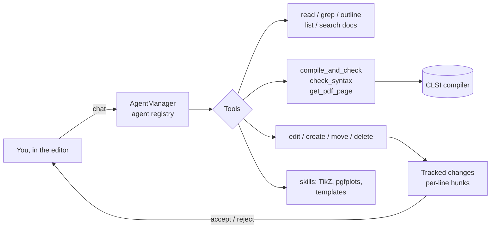

<div align="center">

# dBackSlash

**An AI agent that works inside your LaTeX project: it reads, edits, compiles and fixes, and you review every change.**


</div>

dBackSlash is a research project at the University of Granada (Beca de Iniciación a la
Investigación). It builds an agent into a fork of Overleaf Community Edition, so the agent sees
the project the way a user does: the source files, the compile log, the PDF, the outline and the
history. Its edits arrive as **tracked changes**, which you accept or reject like a co-author's.

## Why inside Overleaf

A plain "LLM + bash + pdflatex" setup only sees `.tex` files and a raw log. Inside the editor the
agent also gets the resolved `.aux`/`.toc`/`.bbl` after each compile, a live index of every
`\label`, `\ref` and `\cite`, the editor's own structured log parser, full attributed change
history, and track changes for safe review. Details: [`doc/capabilities.md`](doc/capabilities.md).

## What the agent can do



- **Tools:** `read_file`, `edit_file`, `create_file`, `move_file`, `delete_file`, `list_files`,
  `grep`, `get_outline`, `search_docs`, `compile_and_check`, `check_syntax`, `get_pdf_page`,
  `ask_question`, `auto_accept_track_changes`, `list_skills`, `read_skill`.
- **Skills:** 7 libraries the agent loads on demand: TikZ (2D, 3D, flowcharts, CS, engineering
  and maths diagrams), pgfplots charts and document templates.
- **Sees what you see:** the agent uses the editor's own CodeMirror linter and log parsers, so
  its errors match the ones in your UI.
- **Safe by design:** agent edits become per-line tracked-change hunks, every message can be
  rolled back through project-history snapshots, and runs can be cancelled mid-flight.
- **Agents are data:** each agent is a (prompt, tool set, model, decoding) config in one
  registry, so you can swap models, prompts or tools without code changes
  ([`doc/agents.md`](doc/agents.md)).
- **Cost control:** per-user output-token and cost caps.

## Benchmark harness

[`doc/benchmark.md`](doc/benchmark.md) describes an offline harness for LaTeX generation tasks
(TeXpert dataset). It compares a one-call `direct-llm` baseline with the live `agent` pipeline.
Each task is scored on whether it compiles to a non-empty PDF and on an LLM-judge rubric (0–10)
against a verified reference.

## Docs

| | |
|---|---|
| [`overview.md`](doc/overview.md) | research goals and architecture |
| [`tools.md`](doc/tools.md) | every tool and its contract |
| [`track-changes.md`](doc/track-changes.md) | how agent edits become reviewable changes |
| [`chat-integration.md`](doc/chat-integration.md) | streaming chat and the editor UI |
| [`providers.md`](doc/providers.md) | model providers |
| [`development-guide.md`](doc/development-guide.md) | running the dev stack |

## Run it

```bash
cd develop
# set your model provider key (see doc/providers.md)
bin/build && bin/up         # or bin/dev for hot reload; details in doc/development-guide.md
```

## Credits and license

dBackSlash is built on [Overleaf Community Edition](https://github.com/overleaf/overleaf), the
open-source collaborative LaTeX editor by Overleaf. All Overleaf code remains under the
[GNU AGPL v3](LICENSE), and so does this fork. The original Overleaf README is at
[`doc/OVERLEAF_README.md`](doc/OVERLEAF_README.md).

Built by [Mohamed Hani](https://github.com/mhanii), University of Granada.
